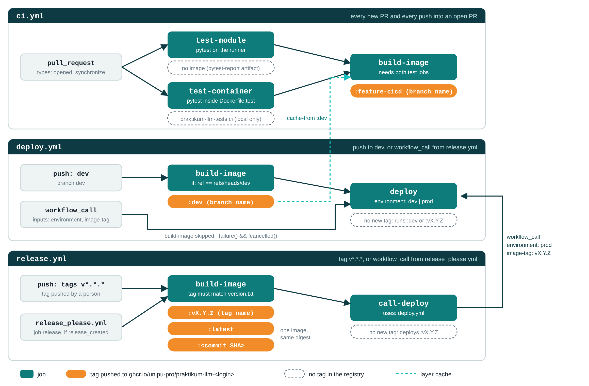

# Vježba (80 min): CI/CD workflowi za praktikum-llm

U tjednu 5 napisali smo prve workflowe (`hello.yml`, `ci.yml`). Danas ih brišemo i pišemo iz početka, ovaj put kao cjelinu koja vodi kod od pull requesta do izdanja:

| Workflow | Pokreće ga | Jobovi | Slika na `ghcr.io` |
|---|---|---|---|
| `ci.yml` | novi PR i novi commit u PR-u (`opened`, `synchronize`) | `test-module`, `test-container`, `build-image` | `:<ime grane>`, npr. `:feature-cicd` |
| `deploy.yml` | `push` na granu `dev` i poziv iz drugog workflowa (`workflow_call`) | `build-image`, `deploy` (zasad rezervirano mjesto) | `:dev` |
| `release.yml` | tag `v*.*.*` i poziv iz `release_please.yml` | `build-image`, `call-deploy` | `:v1.3.0`, `:latest`, `:<SHA commita>` |



> ### 🎯 Ishod vježbe
> U osobnom repozitoriju `praktikum-<github-korisnik>` spojen je PR s grane `feature/cicd` u kojem su stari workflowi obrisani, a `ci.yml`, `deploy.yml` i `release.yml` napisani iz početka. Grana `dev` objavila je sliku `:dev` i "isporučila" je u okruženje `dev`, a izdanje `vX.Y.Z` objavilo je sliku s tri taga i "isporučilo" je u okruženje `prod`. U opisu PR-a su odgovori na dva pitanja za razumijevanje.
>
> **Kriteriji prihvaćanja:**
> 1. U `.github/workflows/` su samo `ci.yml`, `deploy.yml`, `release.yml` i `release_please.yml`; `hello.yml`, stari `ci.yml` i `publish.yml` su obrisani.
> 2. `ci` na PR-u ima tri zelena joba: `test-module` i `test-container` rade usporedno, `build-image` čeka oba i pusha sliku `:<ime grane>`; u logu `build-image` vidi se uvoz cachea sa `:dev`.
> 3. Ruleset `protect-main` traži provjere `test-module`, `test-container` i `build-image` (umjesto `test` i `docker`).
> 4. Postoje okruženja `dev` i `prod`, svako s varijablom `DEPLOY_HOST` i pravilom koje grane i tagovi smiju u njega.
> 5. Push na `dev` pokrenuo je `deploy` s oba joba; u *Packages* postoji tag `:dev`, a sažetak joba `deploy` pokazuje poslužitelj iz okruženja `dev`.
> 6. Izdanje `vX.Y.Z`: `release.yml` je objavio `:vX.Y.Z`, `:latest` i `:<SHA>` s **istim digestom**, a `call-deploy` je pokrenuo samo job `deploy` iz `deploy.yml` (u okruženju `prod`; `build-image` preskočen).
> 7. Poruke commitova i naslov PR-a slijede Conventional Commits; zadnji commit nosi podnožje `Release-As:` (korak 3.2).
>
> **Predaja:** spojen PR iz `feature/cicd`, s odgovorima na pitanja za razumijevanje u opisu PR-a.

| Sadržaj | Okvirno |
|---|---|
| 0. Polazište: brisanje starih workflowa | 5 min |
| 1. `ci.yml`: testovi modula, testovi u kontejneru, slika grane; ruleset | 25 min |
| 2. `deploy.yml`: okruženja `dev` i `prod`, grana `dev`, cache sa `:dev` | 20 min |
| 3. `release.yml`: izdanje, tri taga, isporuka u `prod` | 25 min |
| Rezerva | 5 min |

**Priprema kod kuće:** `gh auth status` s opsegom `workflow` (`gh auth refresh -s workflow`) i `read:packages` (`gh auth refresh -s read:packages`). PR iz tjedna 5 (`feature/ci`) spojen je u `main` ili ga nastavnik zatvara: danas ga ionako zamjenjujemo.

---

## 0. Polazište: brisanje starih workflowa

```bash
cd ~/praktikum-$(gh api user -q .login)
git checkout main
git pull
git checkout -b feature/cicd
ls .github/workflows/
git rm --ignore-unmatch .github/workflows/hello.yml .github/workflows/ci.yml .github/workflows/publish.yml
ls .github/workflows/                    # only release_please.yml is left
```
`release_please.yml` ostaje: on i dalje vodi verzije (`version.txt`, `CHANGELOG.md`, tagovi `vX.Y.Z`). U koraku 3 dobiva jedan novi job.

Sva tri nova workflowa slažu ime slike na isti način kao u tjednu 5: `ghcr.io/unipu-pro/praktikum-llm-<github-korisnik>` (login iz varijable `GITHUB_ACTOR`, tj. vaš GitHub login, malim slovima). Mijenja se samo **tag**.

---

## 1. `ci.yml`: testovi modula, testovi u kontejneru i slika grane

Napraviti `.github/workflows/ci.yml`:
```yaml
# Week 6: continuous integration for praktikum-llm, rewritten from scratch.
# Runs on every new pull request and on every push into an open pull request:
#   test-module     unit tests with pytest directly on the runner
#   test-container  the same tests inside the image built from Dockerfile.test
#   build-image     builds the runtime image (layers reused from :dev) and pushes it
#                   as ghcr.io/<org>/praktikum-llm-<login>:<branch name>
name: ci

on:
  pull_request:
    types:
      - opened                    # the PR is created
      - synchronize               # a new commit is pushed to the PR branch

permissions:
  contents: read
  packages: write                 # GITHUB_TOKEN may push to and read from ghcr.io

jobs:
  test-module:
    runs-on: ubuntu-latest
    steps:
      - uses: actions/checkout@v7

      - uses: actions/setup-python@v7
        with:
          python-version: "3.13"                  # same Python as the image (python:3.13-alpine)
          cache: pip
          cache-dependency-path: requirements*.txt

      - name: Install dependencies
        run: pip install -r requirements-dev.txt

      - name: Unit tests
        run: python -m pytest -v --junitxml=pytest-report.xml

      - name: Upload the test report
        if: always()                              # also (especially) when the tests fail
        uses: actions/upload-artifact@v7
        with:
          name: pytest-report
          path: pytest-report.xml

  test-container:
    runs-on: ubuntu-latest                        # runs in parallel with test-module
    steps:
      - uses: actions/checkout@v7

      - uses: docker/setup-buildx-action@v4

      - name: Build the test image
        uses: docker/build-push-action@v7
        with:
          context: .
          file: Dockerfile.test
          load: true                              # keep the image in the runner's Docker, do not push it
          tags: praktikum-llm-tests:ci
          cache-from: type=gha,scope=tests
          cache-to: type=gha,scope=tests,mode=max

      - name: Unit tests inside the container
        run: docker run --rm praktikum-llm-tests:ci   # exit code of the container = exit code of pytest

  build-image:
    needs:
      - test-module
      - test-container
    runs-on: ubuntu-latest
    steps:
      - uses: actions/checkout@v7

      - name: Name and tag the image
        id: image
        run: |
          name="ghcr.io/${GITHUB_REPOSITORY_OWNER,,}/praktikum-llm-${GITHUB_ACTOR,,}"
          tag="${GITHUB_HEAD_REF//[^a-zA-Z0-9_.-]/-}"               # feature/ci-cd -> feature-ci-cd
          echo "name=$name" >> "$GITHUB_OUTPUT"
          echo "ref=$name:$tag" >> "$GITHUB_OUTPUT"

      - uses: docker/setup-buildx-action@v4

      - name: Log in to ghcr.io
        uses: docker/login-action@v4              # before the build: the :dev cache is in the (private) registry
        with:
          registry: ghcr.io
          username: ${{ github.actor }}
          password: ${{ secrets.GITHUB_TOKEN }}

      - name: Build and push the image
        uses: docker/build-push-action@v7
        with:
          context: .
          push: true
          tags: ${{ steps.image.outputs.ref }}
          cache-from: type=registry,ref=${{ steps.image.outputs.name }}:dev   # layers of the last dev image

      - name: Job summary
        env:
          IMAGE: ${{ steps.image.outputs.ref }}
        run: echo "Pushed \`$IMAGE\`" >> "$GITHUB_STEP_SUMMARY"
```
| Job | Što radi | Novo u odnosu na tjedan 5 |
|---|---|---|
| `test-module` | pytest izravno na runneru (Python 3.13), JUnit izvještaj kao artefakt | samo novo ime (bio je `test`) |
| `test-container` | gradi sliku iz `Dockerfile.test` i pokreće je; izlazni kod kontejnera je rezultat | zaseban job, radi **usporedno** s `test-module` |
| `build-image` | gradi sliku alata i pusha je s tagom imena grane | `needs` s dva joba; cache iz registra (`:dev`) umjesto GitHubovog cachea; tag je grana, a ne SHA |

- `needs:` je popis: `build-image` počinje tek kad su **oba** testna joba zelena.
- **Tag je ime grane.** `GITHUB_HEAD_REF` je grana PR-a (`feature/cicd`); `/` nije dopušten u tagu slike, pa ga bash zamijeni s `-` (`feature-cicd`). Svaki novi push u PR **premješta** isti tag na novu sliku. Ime grane piše korisnik, zato ga čitamo kao varijablu okoline (`$GITHUB_HEAD_REF`), a ne kao `${{ github.head_ref }}` u skripti (script injection, tjedan 5).
- **`cache-from: type=registry,ref=...:dev`**: buildx prije gradnje pogleda sliku `:dev` u registru i preuzme slojeve koji se nisu promijenili. Sliku `:dev` još nemamo (nastaje u koraku 2), pa će prvi put u logu pisati da cache nije pronađen; build ipak prolazi.
- Prijava u `ghcr.io` ide **prije** gradnje: paket je privatan, pa bez prijave buildx ne može pročitati ni cache.

```bash
git add .github/workflows/
git commit -m "<type>: replace old workflows with ci.yml"
git push -u origin HEAD
gh pr create --base main --title "<type>: CI/CD workflows" --body "Week 6."
gh pr checks --watch                     # test-module, test-container, then build-image
```
Na stranici pokretanja pogledati graf: dva testna joba usporedno, zatim `build-image`. U logu koraka *Build and push the image* potražiti redak o uvozu cachea (`importing cache manifest from ...:dev`) i poruku da ga nema.

> ### ❓ Pitanje za razumijevanje 1
> **Kako pytest komunicira s Ollama poslužiteljem u jobu `test-container`? Kako bi takva CI implementacija trebala izgledati u stvarnom okruženju?**
>
> Pomoć: na runneru nema Ollame, a kontejner je pokrenut bez mreže `backend` i bez `OLLAMA_BASE_URL`. Pogledati fiksturu `fake_request` u `tests/test_ollama_client.py` i `compose.yaml` iz tjedna 4. Odgovor upisati u opis PR-a (`gh pr edit --body-file ...` ili na GitHubu).

### 1.1 Ruleset traži nove provjere
Ruleset `protect-main` iz tjedna 5 još traži provjere `test` i `docker`, koje više ne postoje: PR bi zauvijek čekao (*Expected — Waiting for status to be reported*).

*Settings → Rules → Rulesets → protect-main → Require status checks to pass*: ukloniti `test` i `docker`, dodati `test-module`, `test-container` i `build-image` (nude se jer su se upravo jednom izvele). *Save changes.* Na PR-u uz tri provjere sada piše *Required*.

---

## 2. `deploy.yml`: okruženja, grana `dev` i slika `:dev`

### 2.1 Okruženja `dev` i `prod`
Na koji se poslužitelj isporučuje ne piše u workflowu, nego u **okruženju** (*environment*) na GitHubu. Isti `deploy.yml` isporučuje u `dev` ili u `prod`; razlikuju se samo varijable okruženja.

*Settings → Environments → New environment*:

| Okruženje | *Deployment branches and tags* | *Environment variables* |
|---|---|---|
| `dev` | *Selected branches and tags* → grana `dev` | `DEPLOY_HOST` = `praktikum-dev` |
| `prod` | *Selected branches and tags* → grana `main` i tag `v*.*.*` | `DEPLOY_HOST` = `praktikum-prod` |

`DEPLOY_HOST` je zasad samo ime; sljedeći tjedan postaje adresa VM-a na GCP-u. Pravila grana i tagova su zaštita: job koji traži okruženje `prod` s bilo koje druge grane GitHub odbije prije nego što počne. Zašto `prod` dopušta i granu `main`, vidjet ćemo u koraku 3.

### 2.2 Workflow
Napraviti `.github/workflows/deploy.yml`:
```yaml
# Week 6: build the dev image and deploy an image to an environment (replaces publish.yml).
#   push to dev    -> build-image (pushes :dev) -> deploy to the environment `dev`
#   workflow_call  -> deploy only: the caller (release.yml) already built the image and names the environment
# Which server is the target is NOT in this file: it is the variable DEPLOY_HOST of the GitHub environment
# (Settings -> Environments -> dev / prod -> Environment variables).
name: deploy

on:
  push:
    branches:
      - dev
  workflow_call:
    inputs:
      environment:
        description: "GitHub environment to deploy to (dev or prod)"
        type: string
        required: true
      image-tag:
        description: "Tag of the image in ghcr.io to deploy"
        type: string
        required: true

permissions:
  contents: read
  packages: write                 # GITHUB_TOKEN may push to and read from ghcr.io

jobs:
  build-image:
    # Inside a called workflow the github context belongs to the CALLER: when release.yml calls us after a tag push,
    # github.event_name is "push" here too. The ref tells the two cases apart: refs/heads/dev vs refs/tags/v1.3.0.
    if: github.ref == 'refs/heads/dev'
    runs-on: ubuntu-latest
    outputs:
      tag: ${{ steps.image.outputs.tag }}
    steps:
      - uses: actions/checkout@v7

      - name: Name and tag the image
        id: image
        run: |
          name="ghcr.io/${GITHUB_REPOSITORY_OWNER,,}/praktikum-llm-${GITHUB_ACTOR,,}"
          {
            echo "name=$name"
            echo "tag=$GITHUB_REF_NAME"                               # branch name: dev
            echo "ref=$name:$GITHUB_REF_NAME"
          } >> "$GITHUB_OUTPUT"

      - uses: docker/setup-buildx-action@v4

      - name: Log in to ghcr.io
        uses: docker/login-action@v4
        with:
          registry: ghcr.io
          username: ${{ github.actor }}
          password: ${{ secrets.GITHUB_TOKEN }}

      - name: Build and push the image
        uses: docker/build-push-action@v7
        with:
          context: .
          push: true
          tags: ${{ steps.image.outputs.ref }}
          cache-from: type=registry,ref=${{ steps.image.outputs.ref }}   # the previous :dev
          cache-to: type=inline                   # store cache metadata in :dev itself, for ci.yml and the next push

  deploy:
    needs: build-image
    # Default `if` is success(): a skipped build-image (workflow_call) would skip deploy too.
    # Run unless build-image failed or the run was cancelled.
    if: ${{ !failure() && !cancelled() }}
    runs-on: ubuntu-latest
    environment:
      name: ${{ inputs.environment || 'dev' }}   # push to dev -> no inputs -> dev
    concurrency:
      group: deploy-${{ inputs.environment || 'dev' }}
      cancel-in-progress: false                # never stop a deployment halfway; queue the next one
    steps:
      - name: Deploy (placeholder, week 7 replaces it)
        env:
          ENVIRONMENT: ${{ inputs.environment || 'dev' }}
          IMAGE_TAG: ${{ inputs.image-tag || needs.build-image.outputs.tag }}
          DEPLOY_HOST: ${{ vars.DEPLOY_HOST }}    # environment variable of the GitHub environment above
        run: |
          image="ghcr.io/${GITHUB_REPOSITORY_OWNER,,}/praktikum-llm-${GITHUB_ACTOR,,}:$IMAGE_TAG"
          if [ -z "$DEPLOY_HOST" ]; then
            echo "::error::Variable DEPLOY_HOST is not set in the environment '$ENVIRONMENT'"
            exit 1
          fi
          echo "Would deploy $image to $DEPLOY_HOST (environment $ENVIRONMENT)"
          echo "### Deploy to \`$ENVIRONMENT\`: \`$image\` -> \`$DEPLOY_HOST\` (placeholder)" >> "$GITHUB_STEP_SUMMARY"
```
| Mjesto | Zašto |
|---|---|
| `on: push: branches: - dev` + `on: workflow_call` | isti workflow pokreće push na `dev` i poziv iz `release.yml`; `workflow_call` ima vlastite ulaze (`environment`, `image-tag`) |
| `if: github.ref == 'refs/heads/dev'` na `build-image` | u pozvanom workflowu kontekst `github` pripada **pozivatelju**: kad `release.yml` (pokrenut tagom) pozove `deploy.yml`, `github.event_name` je i ovdje `push`. Razlikuje ih `github.ref`: grana `dev` ili tag |
| `cache-to: type=inline` | slika `:dev` sama nosi podatke o cacheu, pa iz nje čitaju `ci.yml`, `release.yml` i sljedeći push na `dev` |
| `if: ${{ !failure() && !cancelled() }}` na `deploy` | zadani uvjet je `success()`: kad je `build-image` preskočen (poziv iz `release.yml`), bez ovoga bi se preskočio i `deploy` |
| `environment: name: ${{ inputs.environment \|\| 'dev' }}` | push na `dev` nema ulaza, pa je okruženje `dev`; poziv šalje `prod` |
| `vars.DEPLOY_HOST` | varijabla okruženja iz koraka 2.1; job je vidi jer navodi `environment` |
| `concurrency` | dvije isporuke u isto okruženje čekaju jedna drugu, a započeta se ne prekida |

Job `deploy` je rezervirano mjesto: provjeri da je `DEPLOY_HOST` postavljen i ispiše što bi isporučio. Tjedan 7 ga zamjenjuje stvarnom isporukom preko SSH-a.

### 2.3 Grana `dev`
```bash
git add .github/workflows/deploy.yml
git commit -m "<type>: add deploy workflow"
git push                                  # synchronize -> ci
git push origin HEAD:dev                  # creates the branch dev on GitHub -> deploy
gh run list --workflow deploy.yml
gh run watch
```
Provjeriti:
- graf pokretanja `deploy`: `build-image` → `deploy`, a uz `deploy` piše okruženje `dev`; na stranici repozitorija desno se pojavio *Deployments*,
- u *Packages* je novi tag `:dev`,
- sažetak joba `deploy`: `praktikum-llm-<github-korisnik>:dev -> praktikum-dev`.

Sada ponovno pokrenuti `ci` na PR-u (*Actions → ci → Re-run all jobs* ili `gh run rerun <id>`). U logu `build-image` cache sa `:dev` je sada pronađen, a koraci `pip install` i `COPY` su `CACHED`. Usporediti trajanje koraka s prvim pokretanjem.

---

## 3. `release.yml`: izdanje s tri taga i isporuka u `prod`

### 3.1 Workflow i most iz `release_please.yml`
Napraviti `.github/workflows/release.yml`:
```yaml
# Week 6: release an image when a version tag (v1.3.0) appears, then deploy it to prod.
#   build-image   builds the image of the tagged commit and pushes three tags: :v1.3.0, :latest, :<commit SHA>
#   call-deploy   calls deploy.yml (workflow_call) with the prod environment
# Triggers:
#   push of a tag v*.*.*   -> a tag pushed by a person (git push origin v1.3.0)
#   workflow_call          -> release_please.yml after release-please has created a release; its tag was created
#                             with GITHUB_TOKEN, and events caused by GITHUB_TOKEN never start new workflow runs
name: release

on:
  push:
    tags:
      - "v*.*.*"
  workflow_call:
    inputs:
      tag:
        description: "Release tag, e.g. v1.3.0"
        type: string
        required: true

permissions:
  contents: read
  packages: write                 # GITHUB_TOKEN may push to and read from ghcr.io

jobs:
  build-image:
    runs-on: ubuntu-latest
    concurrency:
      group: release-image                      # two releases at once must not race for :latest
      cancel-in-progress: false
    outputs:
      tag: ${{ steps.image.outputs.tag }}
    steps:
      - uses: actions/checkout@v7

      - name: Name and tag the image
        id: image
        env:
          TAG: ${{ inputs.tag || github.ref_name }}   # workflow_call: input; tag push: the tag itself
        run: |
          if [ "$TAG" != "v$(cat version.txt)" ]; then
            echo "::error::Tag $TAG does not match version.txt ($(cat version.txt))"
            exit 1
          fi
          name="ghcr.io/${GITHUB_REPOSITORY_OWNER,,}/praktikum-llm-${GITHUB_ACTOR,,}"
          {
            echo "name=$name"
            echo "tag=$TAG"
            echo "tags<<EOF"                      # multi-line output: one image tag per line
            echo "$name:$TAG"
            echo "$name:latest"
            echo "$name:$GITHUB_SHA"
            echo "EOF"
          } >> "$GITHUB_OUTPUT"

      - uses: docker/setup-buildx-action@v4

      - name: Log in to ghcr.io
        uses: docker/login-action@v4
        with:
          registry: ghcr.io
          username: ${{ github.actor }}
          password: ${{ secrets.GITHUB_TOKEN }}

      - name: Build and push the image
        uses: docker/build-push-action@v7
        with:
          context: .
          push: true
          tags: ${{ steps.image.outputs.tags }}           # one tag per line
          cache-from: type=registry,ref=${{ steps.image.outputs.name }}:dev

      - name: Job summary
        env:
          TAGS: ${{ steps.image.outputs.tags }}
        run: |
          {
            echo "### Released"
            for ref in $TAGS; do
              echo "- $ref"
            done
          } >> "$GITHUB_STEP_SUMMARY"

  call-deploy:
    needs: build-image
    uses: ./.github/workflows/deploy.yml
    with:
      environment: prod
      image-tag: ${{ needs.build-image.outputs.tag }}
```
- **Tri taga, jedna slika:** `build-push-action` gradi jednom i istu sliku (isti digest) objavi pod `:vX.Y.Z` (nepromjenjiv po dogovoru), `:latest` (pomični) i `:<SHA commita>` (veza s kodom).
- **Provjera verzije:** tag mora odgovarati `version.txt`; inače bi slika `:v1.3.0` ispisivala `llm 1.2.0`.
- **`call-deploy`** nema `runs-on` ni `steps`: cijeli job je poziv `deploy.yml` s `environment: prod`. Nema ni vlastitih `permissions`: pozvani workflow dobiva token pozivatelja, a `packages: write` na razini `release.yml` pokriva i `deploy.yml` (pozvani workflow ne smije tražiti više dopuštenja od pozivatelja).

Zašto i `workflow_call`? Tag `vX.Y.Z` stvara release-please s `GITHUB_TOKEN`om, a **događaji koje izazove `GITHUB_TOKEN` ne pokreću nove workflowe** (zaštita od beskonačnih petlji). Tag bi nastao, a `release.yml` se ne bi pokrenuo. Zato `release_please.yml` dobiva job koji ga pozove sam kad je izdanje stvoreno. Zamijeniti `.github/workflows/release_please.yml`:
```yaml
name: release-please

on:
  push:
    branches:
      - main

permissions:
  contents: write
  pull-requests: write
  packages: write

jobs:
  dump-github-context:
    runs-on: ubuntu-latest
    steps:
      - name: Dump GitHub context
        env:
          GITHUB_CONTEXT: ${{ toJson(github) }}
        run: echo "$GITHUB_CONTEXT"

  release-please:
    runs-on: ubuntu-latest
    outputs:
      release_created: ${{ steps.release.outputs.release_created }}
      tag_name: ${{ steps.release.outputs.tag_name }}
    steps:
      - name: Release Please
        id: release
        uses: googleapis/release-please-action@v4
        with:
          release-type: simple

  # Week 6: the tag that release-please creates with GITHUB_TOKEN does not start release.yml
  # (events caused by GITHUB_TOKEN never start new workflow runs), so we call it ourselves.
  release:
    needs: release-please
    if: needs.release-please.outputs.release_created == 'true'
    uses: ./.github/workflows/release.yml
    with:
      tag: ${{ needs.release-please.outputs.tag_name }}
```
U tom slučaju `github.ref` je `refs/heads/main` (pokrenuo ga je push na `main`), a ne tag. Zato okruženje `prod` dopušta i granu `main`, a `release.yml` tag čita iz ulaza `inputs.tag`.

### 3.2 Izdanje
Release-please povećava verziju samo za `feat` i `fix`, a današnje promjene su u CI-u. Verziju zato tražimo izričito podnožjem `Release-As:` u zadnjem commitu. Sljedeća minor verzija: ako `version.txt` sadrži `1.2.0`, piše se `1.3.0`.
```bash
cat version.txt
git add .github/workflows/release.yml .github/workflows/release_please.yml
git commit -m "<type>: add release workflow" -m "Release-As: X.Y.0"
git push
gh pr checks --watch                      # three required checks, green
gh pr merge --merge                       # main accepts only PRs (ruleset); merge commit, as agreed
```
Nakon spajanja `release_please.yml` otvara (ili ažurira) release PR `chore(main): release X.Y.0`. Njega je otvorio `GITHUB_TOKEN`, pa `ci` na njemu ne krene; spaja se preko bypassa iz tjedna 5:
```bash
gh pr list                                # chore(main): release X.Y.0
gh pr merge <number> --merge --admin
gh run list --workflow release_please.yml
gh run watch
```
Graf pokretanja `release-please`: `release-please` → `release / build-image` → `release / call-deploy / deploy` (okruženje `prod`). Job `build-image` iz `deploy.yml` je preskočen.

Provjeriti da su tri taga ista slika:
```bash
gh auth token | docker login ghcr.io -u "$(gh api user -q .login)" --password-stdin
IMAGE=ghcr.io/unipu-pro/praktikum-llm-$(gh api user -q .login | tr A-Z a-z)
git pull && git log -1 --format=%H        # the release commit
for tag in "v$(cat version.txt)" latest "$(git rev-parse HEAD)"; do
  docker buildx imagetools inspect "$IMAGE:$tag" --format '{{json .Manifest.Digest}}'
done                                      # three times the same sha256:...
docker run --rm "$IMAGE:latest" --version # llm X.Y.0
```

> ### ❓ Pitanje za razumijevanje 2
> **Što su zastarjele slike i kako ih čistiti? Kako smo sigurni da će tag `:latest` uvijek imati zadnje promjene?**
>
> Pomoć: otvoriti *Packages → praktikum-llm-<github-korisnik>* i pogledati sve verzije (i one bez taga) nakon današnjih pokretanja i onih iz tjedna 5. Za `:latest` razmisliti što se dogodi s popravkom `v1.2.1` objavljenim nakon `v1.3.0`. Odgovor upisati u opis PR-a.

---

## Predaja
Spojen PR iz `feature/cicd` s odgovorima na pitanja 1 i 2 u opisu. Nastavnik provjerava kriterije 1–7 na kartici *Actions*, u *Packages*, *Settings → Environments* i *Settings → Rules*.

## Česti problemi
| Simptom | Rješenje |
|---|---|
| PR stoji na *Expected — Waiting for status to be reported* za `test` i `docker` | Ruleset još traži stare provjere: korak 1.1 |
| `build-image`: `failed to configure registry cache importer ... not found` | Očekivano dok `:dev` ne postoji (prije koraka 2.3); build prolazi bez cachea |
| `build-image`: `denied: permission_denied` ili `write_package` | Workflow nema `permissions:` s `packages: write` ili prijava u `ghcr.io` nije prije builda |
| `deploy`: `Variable DEPLOY_HOST is not set in the environment 'dev'` | Varijabla je dodana kao *repository variable* ili tajna, a ne u okruženje; ili ime okruženja nije točno `dev` |
| `deploy`: `Branch "feature/cicd" is not allowed to deploy to dev due to environment protection rules` | Očekivano: u `dev` smije samo grana `dev`. Pushati na `dev` (`git push origin HEAD:dev`) |
| `deploy` je *skipped* nakon poziva iz `release.yml` | Nedostaje `if: ${{ !failure() && !cancelled() }}` na jobu `deploy` |
| `release.yml` ili `release_please.yml`: `The nested job 'build-image' is requesting 'packages: write', but is only allowed 'packages: none'` | Pozivatelj (`release.yml`, `release_please.yml`) mora na razini workflowa imati `packages: write`; inače pozvani workflow ne smije tražiti to dopuštenje |
| `Tag vX.Y.Z does not match version.txt` | Tag je ručno stvoren na commitu bez nove verzije; izdanje ide kroz release-please (korak 3.2) |
| Release PR se ne pojavljuje | Podnožje mora biti odvojeni odlomak commita (`-m "..." -m "Release-As: X.Y.0"`), točno tim imenom i s ispravnom verzijom |
| Spojen release PR, a `release.yml` se ne pokreće | U `release_please.yml` nedostaje job `release` (most) ili `id: release` na koraku release-please |
| `git push` u `main`: `GH013: Repository rule violations found` | Očekivano: promjene idu kroz PR (`gh pr merge`) |
